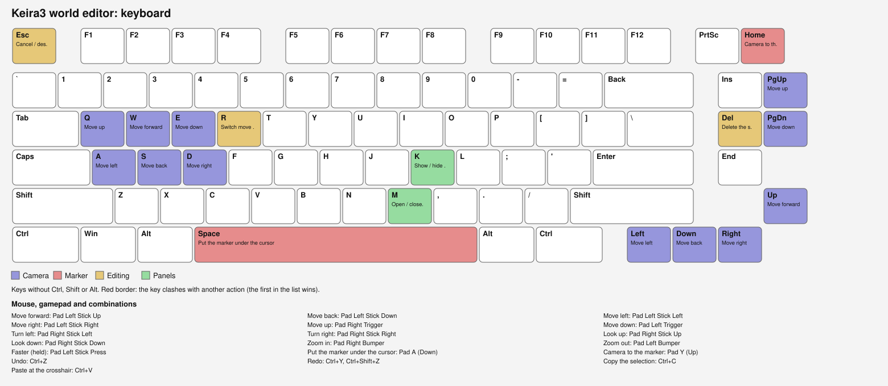
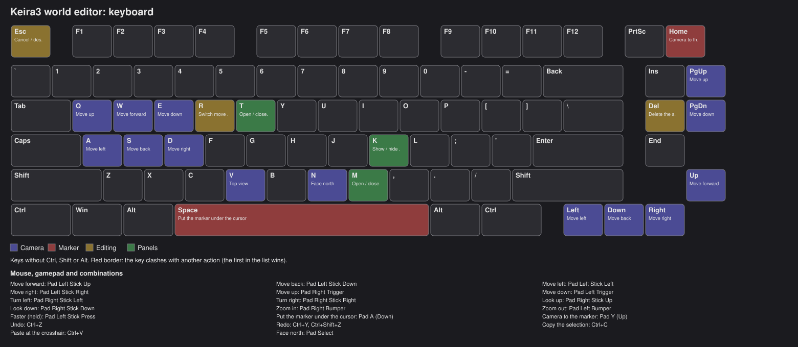
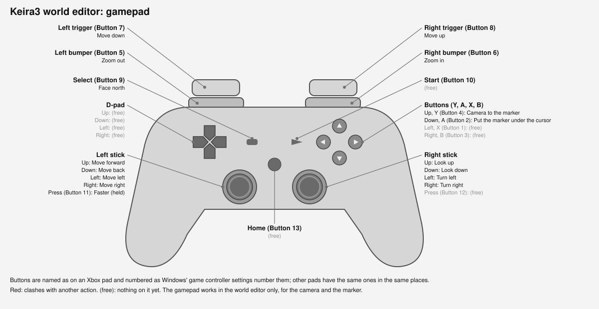
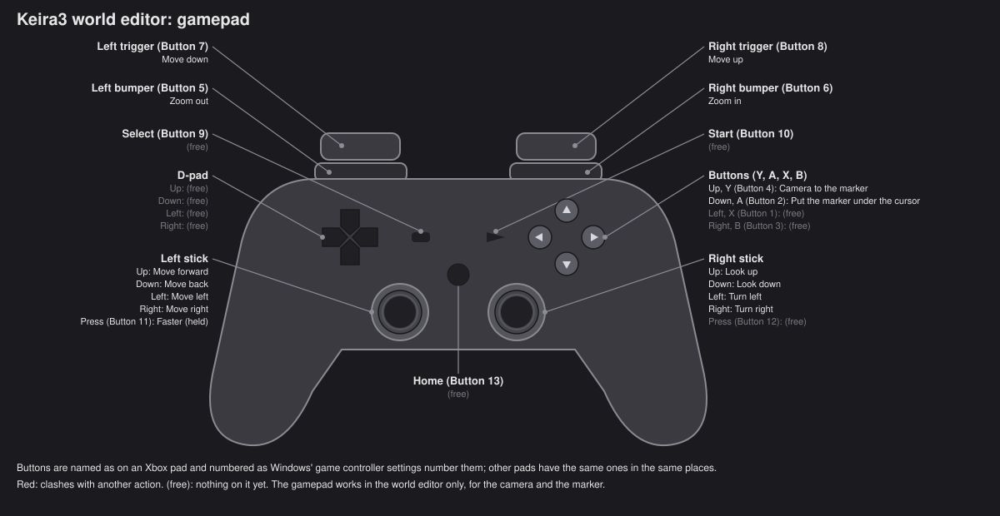

# World editor controls

The default controls of the 3D world editor (**World Editor** in Keira3's menu). They can all be changed in the editor's
**Controls** panel: click an action, then press a key, a mouse button or a gamepad button (or pick a mouse input from the
list), as many as you like per action. **Esc** cancels. An input shown in orange is also on another action that is never
active at the same time (fine); in red it clashes with another action, and only the first one in the list fires.

Show Keyboard Layout (Light Theme)

Show Keyboard Layout (Dark Theme)

Show Gamepad Layout (Light Theme)

Show Gamepad Layout (Dark Theme)

## Bindable actions

Generated by `npm run wiki:controls` from the defaults: don't edit between the markers by hand.

<!-- controls:start -->

### Camera

| Action | Mouse | Keyboard | Controller | Note |
|---|---|---|---|---|
| Move forward | - | `W`, `↑` | `Pad Left Stick Up` |  |
| Move back | - | `S`, `↓` | `Pad Left Stick Down` |  |
| Move left | - | `A`, `←` | `Pad Left Stick Left` |  |
| Move right | - | `D`, `→` | `Pad Left Stick Right` |  |
| Move up | - | `Q`, `PageUp` | `Pad Right Trigger` |  |
| Move down | - | `E`, `PageDown` | `Pad Left Trigger` |  |
| Turn left | - | - | `Pad Right Stick Left` |  |
| Turn right | - | - | `Pad Right Stick Right` |  |
| Look up | - | - | `Pad Right Stick Up` |  |
| Look down | - | - | `Pad Right Stick Down` |  |
| Zoom in | - | - | `Pad Right Bumper` |  |
| Zoom out | - | - | `Pad Left Bumper` |  |
| Faster (held) | - | - | `Pad Left Stick Press` |  |
| Face north | - | `N` | `Pad Select` |  |

### Marker

| Action | Mouse | Keyboard | Controller | Note |
|---|---|---|---|---|
| Put the marker under the cursor | - | `Space` | `Pad A (Down)` |  |
| Camera to the marker | - | `Home` | `Pad Y (Up)` |  |

### Editing

| Action | Mouse | Keyboard | Controller | Note |
|---|---|---|---|---|
| Undo | - | `Ctrl+Z` | - |  |
| Redo | - | `Ctrl+Y`, `Ctrl+Shift+Z` | - |  |
| Delete the selection | - | `Delete` | - |  |
| Switch move / rotate | - | `R` | - |  |
| Cancel / deselect | - | `Escape` | - |  |
| Copy the selection | - | `Ctrl+C` | - |  |
| Paste at the crosshair | - | `Ctrl+V` | - |  |

### Panels

| Action | Mouse | Keyboard | Controller | Note |
|---|---|---|---|---|
| Open / close the world map | - | `M` | - |  |
| Show / hide the compass | - | `K` | - |  |
| Open / close the tree | - | `T` | - |  |

<!-- controls:end -->

## Fixed controls

These are not in the Controls panel.

| Input | What it does |
|---|---|
| `Mouse Left` (drag) | Turn the camera around what it looks at |
| `Mouse Right` (drag) | Move the camera sideways |
| `Mouse Wheel` | Zoom in and out |
| `Shift` + `Mouse Wheel` | Camera speed (shown under the crosshair) |
| `Shift` (held) | Camera moves 3 times faster |
| `Mouse Left` (click) | Select a spawn, waypoint or area trigger |
| `Ctrl` + `Mouse Left` | Add a spawn to the selection, or take it out |
| `Mouse Right` (click) | Menu of what's under the cursor (open, copy GUID, `.go` commands...) |
| `Shift` + the marker key (`Shift+Space`) | Put the marker on a liquid surface instead of the ground under it |
| `Alt` (held, over a spawn) | All its details: phases, every quest, each race's standing |
| `Shift` + drag on the world map | Load that area whole |

## The controller

The gamepad works in the world editor tab only, and only for the camera and the marker (editing stays on the keyboard
and mouse). It follows the usual free camera layout:

- **Left stick**: move along the ground, relative to where the camera looks. **Press it in** (held) to go faster.
- **Right stick**: turn and look up or down around what the camera looks at.
- **Triggers**: up (right) and down (left).
- **Bumpers**: zoom in (right) and out (left).
- **A**: put the marker (like Space). **Y**: camera back to the marker (like Home).

Any button or stick direction can be bound to any camera or marker action in the Controls panel, while a gamepad is
connected.
